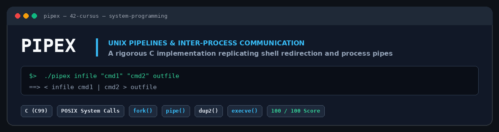
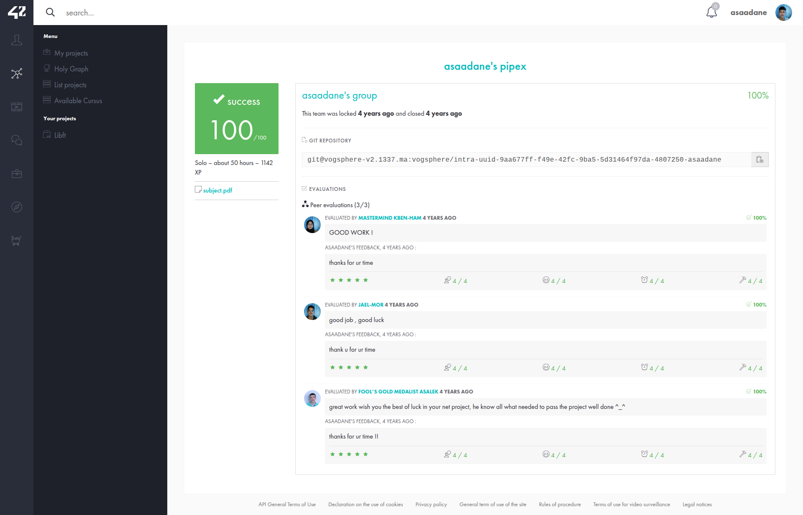
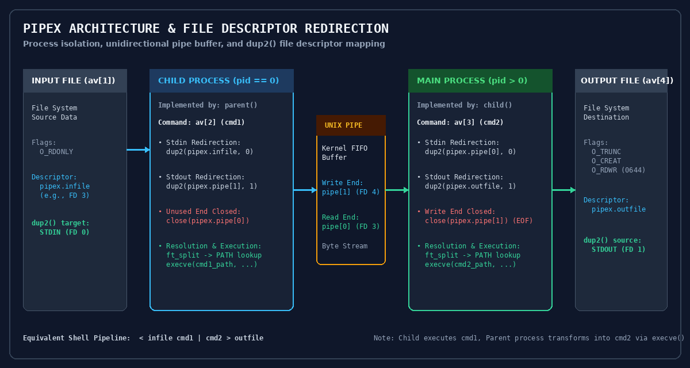

*This project has been created as part of the 42 curriculum by asaadane.*

<div align="center">

# Pipex

### Replicating Unix Shell Pipelines and Process Redirection in C



<p align="center">
  
  
  
  
  
  
</p>

<p align="center">
  <a href="#validation-evidence">
    
  </a>
</p>

</div>

---

## Project Information

| Item | Details |
|---|---|
| **Program Name** | `pipex` (Executable CLI Binary) |
| **Language** | C (C99 / POSIX.1-2008 Standard) |
| **Compiler & Flags** | `cc` with `-Wall -Wextra -Werror -Iincludes` |
| **School** | 1337 Coding School (Khouribga) — 42 Network |
| **System Calls** | `pipe`, `fork`, `dup2`, `execve`, `open`, `close`, `access` |
| **Evaluation Score** | [100% (42 Peer Defense Validated)](pipex-100.png) |
| **Documentation Hub** | [`docs/`](docs/) (`ARCHITECTURE.md`, `PIPE_AND_PROCESSES.md`, `PROJECT_AUDIT.md`, `TESTING.md`) |
| **Author** | Ayman Saadane ([@Shifuuu31](https://github.com/Shifuuu31)) |

---

## Table of Contents

- [Overview](#overview)
- [How It Works](#how-it-works)
- [System Architecture](#system-architecture)
- [Key Technical Concepts](#key-technical-concepts)
- [Project Structure](#project-structure)
- [Installation & Compilation](#installation--compilation)
- [Usage & Execution](#usage--execution)
- [Examples & Shell Equivalence](#examples--shell-equivalence)
- [Error Handling](#error-handling)
- [Learning Outcomes](#learning-outcomes)
- [Validation Evidence](#validation-evidence)
- [Resources & References](#resources--references)
- [Author & Acknowledgments](#author--acknowledgments)

---

## Overview

**Pipex** is an operating systems programming project within the 42 Cursus that reproduces the behavior of Unix shell pipelines and file redirection.

In the shell, pipelines allow programs to compose together by streaming the standard output of one command directly into the standard input of another without temporary intermediate files on disk:

```bash
< infile cmd1 | cmd2 > outfile
```

Pipex replicates this pipeline behavior from scratch in C:

```bash
./pipex infile "cmd1" "cmd2" outfile
```

By working directly with POSIX kernel system calls (`pipe`, `fork`, `dup2`, `execve`), Pipex offers hands-on mastery over process creation, inter-process communication (IPC), file descriptor tables, command path discovery, and stream redirection.

---

## How It Works

When Pipex is executed with an input file, two commands, and an output file:

1. **Validation & File Setup:** Pipex verifies argument counts, opens the source file (`infile`) for reading, and prepares the destination file (`outfile`) with write/create/truncate permissions.
2. **Pipe Creation:** A unidirectional kernel pipe buffer is allocated, providing two file descriptors: a write end (`pipe[1]`) and a read end (`pipe[0]`).
3. **Environment Traversal:** Pipex inspects the system environment (`envp`) to parse `PATH` directories for locating executable binaries.
4. **Process Forking:** The process calls `fork()` to split execution into two branches:
   - **Child Process (`pid == 0`):** Remaps `infile` to `STDIN` and `pipe[1]` to `STDOUT`. Closes the unused read end `pipe[0]`. Locates and executes `cmd1`.
   - **Parent Process (`pid > 0`):** Remaps `pipe[0]` to `STDIN` and `outfile` to `STDOUT`. Closes `pipe[1]` (allowing EOF detection). Locates and executes `cmd2`.
5. **Streaming Execution:** The kernel streams the byte output from `cmd1` into `cmd2` via the pipe buffer. When `cmd1` completes, the closed write descriptor signals `EOF` to `cmd2`, which terminates upon processing all data and writes the final output to `outfile`.

---

## System Architecture

The diagram below illustrates how file descriptors and processes are wired together during execution:



```text
+--------------+      read      +-------------------+
|    infile    | -------------> |   Child (cmd1)    |
| (Input File) |                |   FD 0 = infile   |
+--------------+                |   FD 1 = pipe[1]  |
                                +-------------------+
                                          |
                                          | write to pipe[1]
                                          v
                                +-------------------+
                                |    Kernel Pipe    |
                                |   [FIFO Buffer]   |
                                +-------------------+
                                          |
                                          | read from pipe[0]
                                          v
+--------------+     write      +-------------------+
|   outfile    | <------------- |   Parent (cmd2)   |
| (Dest File)  |                |   FD 0 = pipe[0]  |
+--------------+                |   FD 1 = outfile  |
                                +-------------------+
```

For an in-depth lifecycle walkthrough, see [docs/ARCHITECTURE.md](docs/ARCHITECTURE.md).

---

## Key Technical Concepts

The project relies directly on foundational POSIX system calls:

- **`pipe(int pipefd[2])`**: Creates an inter-process communication channel in kernel space. `pipefd[1]` receives bytes written by `cmd1`, and `pipefd[0]` serves those bytes to `cmd2`.
- **`fork()`**: Clones the running program into concurrent child and parent execution contexts with isolated virtual memory spaces.
- **`dup2(int oldfd, int newfd)`**: Duplicates an open file descriptor onto standard descriptor slots (`0` for STDIN, `1` for STDOUT), transparently redirecting process I/O.
- **`execve(char *path, char **args, char **env)`**: Replaces the calling process image with the specified executable binary.
- **`open()` & `close()`**: Manages lifecycle of file descriptors. In particular, closing `pipe[1]` in the reader process is critical: if any writer descriptor remains open, `cmd2` blocks indefinitely waiting for EOF.
- **PATH Command Resolution**: Scans the `PATH` environment variable and tests candidate paths using `access(candidate, X_OK)` to discover binaries like `/bin/ls` or `/usr/bin/wc`.

For a comprehensive explanation of file descriptors and IPC mechanics, see [docs/PIPE_AND_PROCESSES.md](docs/PIPE_AND_PROCESSES.md).

---

## Project Structure

```text
Pipex_42-cursus/
├── Makefile               # Build automation (-Wall -Wextra -Werror -Iincludes)
├── README.md              # Project presentation & documentation
├── en.subject.pdf         # Official 42 project specification
├── pipex-100.png          # 42 Intra evaluation validation score (100%)
├── includes/
│   └── pipex.h            # Header definitions, struct s_all, prototypes
├── src/
│   ├── main.c             # Argument validation, file opening, pipeline dispatch
│   ├── pipex.c            # Process redirection & child/parent workers
│   ├── path.c             # PATH environment lookup & command resolution
│   ├── cleanup.c          # Memory deallocation & error display
│   ├── ft_split.c         # String tokenization & substring extraction
│   └── str_utils.c        # Core string & memory utilities
├── assets/
│   ├── banner.png         # Repository banner
│   ├── diagrams/          # High-resolution architectural diagrams
│   └── screenshots/       # Terminal verification notes and artifacts
└── docs/
    ├── PROJECT_AUDIT.md   # Complete technical audit & codebase inventory
    ├── ARCHITECTURE.md    # Detailed architectural flow & lifecycle breakdown
    ├── PIPE_AND_PROCESSES.md # Systems programming guide (Pipes, FDs, Redirection)
    └── TESTING.md         # Empirical test results, reproduction steps, test script
```

---

## Installation & Compilation

The project compiles with standard `cc` (or `gcc`/`clang`) using strict 42 compilation flags:

```bash
# Standard compilation
make

# In headless/CI environments where TERM is unset
TERM=xterm make

# Or build the binary directly
make pipex
```

### Makefile Rules

| Rule | Description |
| :--- | :--- |
| `make` / `make all` | Compiles source files and links the `pipex` binary. |
| `make clean` | Removes intermediate object files (`*.o`). |
| `make fclean` | Removes object files and the generated `pipex` executable. |
| `make re` | Performs `fclean` followed by a complete rebuild. |

---

## Usage & Execution

```bash
./pipex <infile> "<cmd1>" "<cmd2>" <outfile>
```

### Parameters

- `infile`: Existing file path providing input to `cmd1`.
- `cmd1`: First shell command with its options/arguments (e.g., `"grep 42"`).
- `cmd2`: Second shell command with its options/arguments (e.g., `"wc -l"`).
- `outfile`: Destination file path where `cmd2` output is written (created or truncated).

---

## Examples & Shell Equivalence

### Example 1: Word Counting Filter
Count lines containing the word "Network":

```bash
# Pipex execution
./pipex data.txt "grep Network" "wc -l" count.txt

# Shell equivalent
< data.txt grep Network | wc -l > count.txt
```

### Example 2: Text Sorting & Truncation
Convert input to uppercase and retrieve top 3 entries:

```bash
# Pipex execution
./pipex names.txt "tr a-z A-Z" "head -n 3" top3.txt

# Shell equivalent
< names.txt tr a-z A-Z | head -n 3 > top3.txt
```

### Example 3: File Inspection
Display file contents with non-printing characters and page first 10 lines:

```bash
# Pipex execution
./pipex src/main.c "cat -e" "head -n 10" preview.txt

# Shell equivalent
< src/main.c cat -e | head -n 10 > preview.txt
```

---

## Error Handling

Pipex enforces strict parameter and system call error checks:

- **Wrong Argument Count:** If `argc != 5`, Pipex terminates immediately with an error message.
- **Infile Inaccessible:** If `infile` does not exist or lacks read permission, Pipex outputs `Infile error !!` and terminates with status `1`.
- **Outfile Inaccessible:** If `outfile` cannot be created or opened for writing, Pipex outputs `Outfile error !!` and terminates with status `1`.
- **Command Not Found:** If a command cannot be located within any directory in `PATH`, Pipex writes `command not found !!` to standard error.
- **Missing Environment:** If `PATH` is unset or stripped from the environment, Pipex exits with an environment error.

All verified error responses are thoroughly benchmarked in [docs/TESTING.md](docs/TESTING.md).

---

## Learning Outcomes

Completing and validating Pipex demonstrates core systems programming capabilities:

- **Low-Level I/O:** Proficient manipulation of POSIX file descriptors, file permissions, and open flags (`O_RDONLY`, `O_TRUNC`, `O_CREAT`, `O_RDWR`).
- **Process Orchestration:** Practical mastery of Unix process lifecycles via `fork()` and process space replacement with `execve()`.
- **Inter-Process Communication:** Designing deadlock-free data pipelines using kernel pipes and atomic descriptor remapping via `dup2()`.
- **Environment & PATH Resolution:** Parsing and traversing POSIX environment arrays without standard library search helpers.
- **Self-Contained C Development:** Writing modular, leak-free utility algorithms without external third-party dependencies.

---

## Validation Evidence

The mandatory part of Pipex was successfully evaluated and validated during 42 school peer defense with a score of **100/100**:

<div align="center">
  
</div>

---

## Resources & References

### Systems Programming Documentation
- `man 2 pipe` — Create inter-process channel
- `man 2 fork` — Create child process
- `man 2 dup2` — Duplicate a file descriptor
- `man 2 execve` — Execute program image
- `man 2 open` / `man 2 close` — File descriptor lifecycle
- *Advanced Programming in the UNIX Environment (APUE)* by W. Richard Stevens

### AI Usage Disclosure
Pursuant to 42 curriculum guidelines, AI assistance was utilized exclusively for repository documentation, architectural diagram generation, empirical audit reporting, and portfolio presentation. No source code was modified or refactored.

---

## Author & Acknowledgments

- **Author:** Ayman Saadane ([@Shifuuu31](https://github.com/Shifuuu31))
- **School:** 1337 Coding School (Khouribga) — 42 Network
- **Evaluation:** [100% (42 Peer Defense Validated)](pipex-100.png)

---

## License & Academic Context

This project was developed by **Ayman Saadane** as part of the **1337 Coding School (Khouribga)** curriculum within the **42 Network**.

- **Intellectual Property:** The source code implementation is the academic work of the author.
- **Academic Integrity:** 1337 and 42 Network projects are governed by strict peer-evaluation and anti-plagiarism policies. Current 42 students are encouraged to use this repository as an architectural learning reference rather than copying code.
- **Licensing Notice:** All rights reserved by the author. No unauthorized redistribution.
