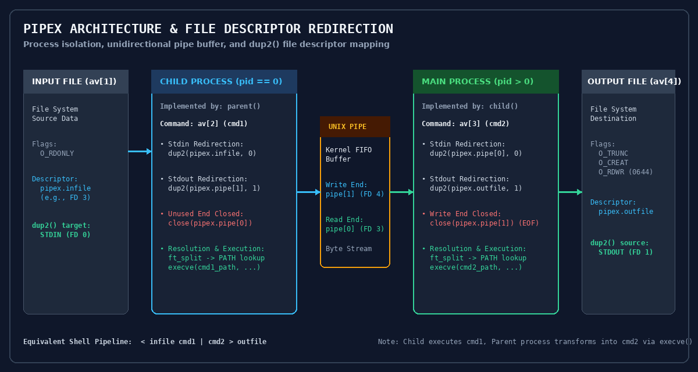
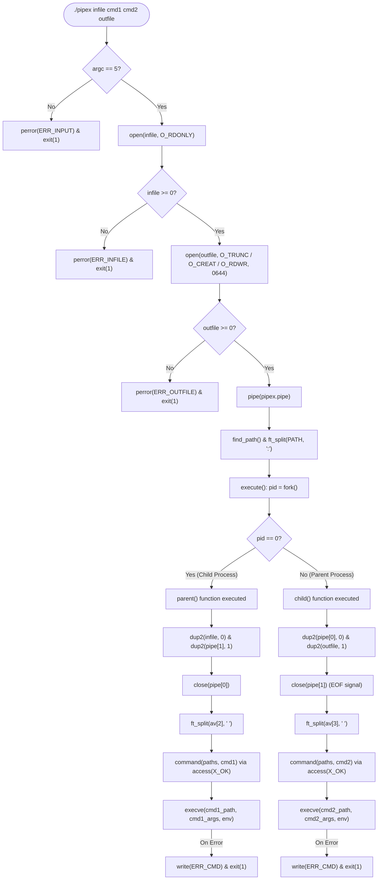
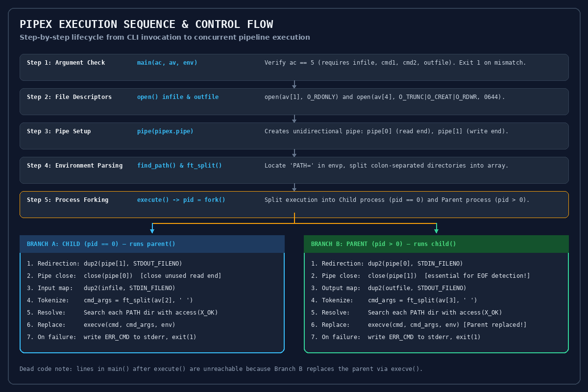

# System Architecture & Execution Lifecycle

> **Component:** Technical Architecture Reference  
> **Project:** Pipex (`42 Cursus`)  
> **Source Files:** `src/main.c`, `src/pipex.c`, `includes/pipex.h`, `src/pipex_tools.c`, `src/pipex_tools_2.c`, `src/pipex_tools_3.c`

---

## 1. Architectural Overview

Pipex reproduces the behavior of standard shell pipelines in C by leveraging POSIX operating system primitives. It connects the standard output of a first program (`cmd1`) to the standard input of a second program (`cmd2`), reading from an input file and writing to a truncated output file:

$$\text{infile} \xrightarrow{\text{read}} \mathbf{cmd1} \xrightarrow{\text{pipe}} \mathbf{cmd2} \xrightarrow{\text{write}} \text{outfile}$$



---

## 2. Source File Responsibilities

The codebase is organized into modular files adhering to the 42 Norm constraints:

```text
Pipex_42-cursus/
├── Makefile               # Compilation orchestration (-Iincludes)
├── includes/
│   └── pipex.h            # Header definitions, struct s_all, prototypes
└── src/
    ├── main.c             # Program entry point, argument validation, flow orchestration
    ├── pipex.c            # Core pipeline: path resolution, fork branching, execve
    ├── pipex_tools.c      # Memory deallocation, string concatenation, error reporting
    ├── pipex_tools_2.c    # Tokenization engine (ft_split, ft_substr, word counting)
    └── pipex_tools_3.c    # String and memory primitives (ft_strlen, ft_memcpy, ft_strdup)
```

### Module Breakdown

| Module | Core Functions | Technical Focus |
| :--- | :--- | :--- |
| **`src/main.c`** | `main()`, `execute()` | CLI input boundary check (`argc == 5`), file descriptor allocation (`open`), pipe creation (`pipe`), environment path extraction, process branching. |
| **`src/pipex.c`** | `find_path()`, `command()`, `parent()`, `child()`, `close_pipes()` | Environment traversal for `PATH=`, binary discovery with `access(X_OK)`, file descriptor redirection with `dup2()`, process image replacement via `execve()`. |
| **`src/pipex_tools.c`** | `ft_strjoin()`, `free_parent()`, `free_child()`, `display_msg()` | Heap string assembly for path concatenation, resource freeing, error message printing via `perror()`. |
| **`src/pipex_tools_2.c`** | `ft_split()`, `ft_substr()` | Whitespace command-string parser converting CLI arguments (e.g. `"grep apple"`) into null-terminated `char **` vector for `execve`. |
| **`src/pipex_tools_3.c`** | `ft_strlen()`, `ft_memcpy()`, `ft_strdup()`, `ft_strncmp()` | Standard C library replacements for string inspection and memory duplication without external library dependencies. |

---

## 3. Execution Lifecycle & Sequence

The program follows a deterministic sequential initialization followed by concurrent process execution:





---

## 4. Detailed Component Mechanics

### 4.1 Process Model Implementation

In contrast to conventional two-child multi-process orchestration, `Pipex_42-cursus` implements an **asymmetric single-fork model**:

1. **Child Process (`pid == 0`):**
   - Dispatched into `parent()` in `pipex.c`.
   - Connects `infile` to `STDIN_FILENO`.
   - Connects `pipe[1]` (write end) to `STDOUT_FILENO`.
   - Closes `pipe[0]` (read end).
   - Replaces its process memory image with `cmd1`.

2. **Parent Process (`pid > 0`):**
   - Dispatched into `child()` in `pipex.c`.
   - Connects `pipe[0]` (read end) to `STDIN_FILENO`.
   - Connects `outfile` to `STDOUT_FILENO`.
   - Closes `pipe[1]` (write end) to ensure reader receives `EOF` when child exits.
   - Replaces its own process memory image with `cmd2`.

### 4.2 File Descriptor State Table

The table below illustrates the file descriptor states throughout the execution cycle:

| Process Context | FD 0 (STDIN) | FD 1 (STDOUT) | FD 2 (STDERR) | `pipe[0]` | `pipe[1]` | `infile` | `outfile` |
| :--- | :--- | :--- | :--- | :--- | :--- | :--- | :--- |
| **Initial (Main)** | Terminal stdin | Terminal stdout | Terminal stderr | Open (Read) | Open (Write) | Open (RO) | Open (RW/Trunc) |
| **Child (`cmd1`)** | **`infile`** | **`pipe[1]`** | Terminal stderr | Closed | Active (FD 1) | Active | Active |
| **Parent (`cmd2`)** | **`pipe[0]`** | **`outfile`** | Terminal stderr | Active (FD 0) | **Closed (EOF)** | Active | Active |

---

## 5. Architectural Trade-offs & Verifications

- **Concurrency:** Because `execve` occurs independently in both child and parent, `cmd1` and `cmd2` run concurrently in the Linux kernel. If `cmd1` produces a continuous stream, `cmd2` consumes it as chunks become available in the pipe buffer.
- **Process Orphanage:** Because the parent process transforms into `cmd2` rather than remaining as an orchestrator calling `waitpid()`, `cmd1` is adopted by the system `init`/systemd daemon once either process completes.
- **Exit Status Parity:** The final exit code returned to the calling shell matches the exit status of `cmd2` (or code `1` if command resolution fails).
